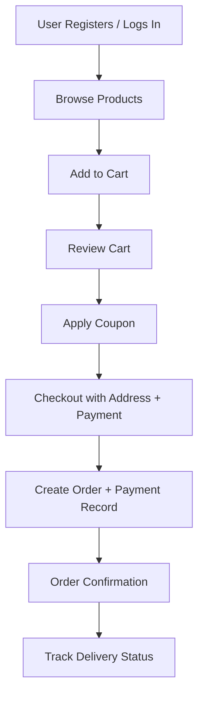
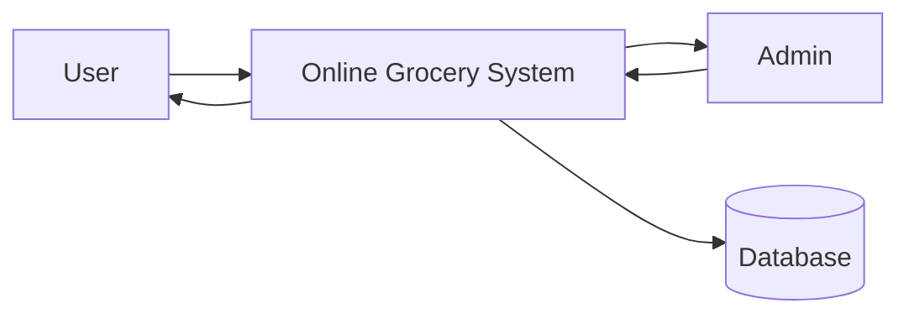
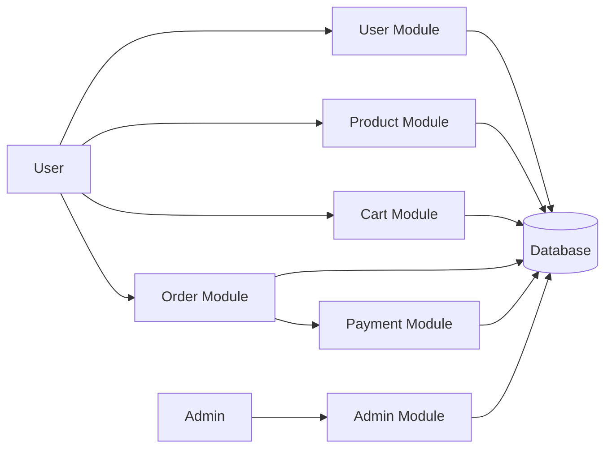
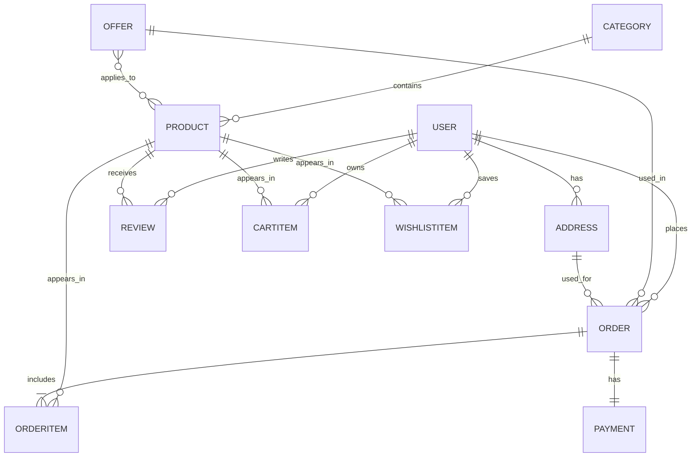

# Online Grocery Delivery System (Django + MySQL)

A complete Django e-commerce platform for online grocery delivery with user authentication, product catalog, cart, wishlist, checkout, coupons, payment simulation, order tracking, and admin reporting.

For a quick local startup guide, see [RUN_APPLICATION.md](RUN_APPLICATION.md).

## Features

### User Features
- Registration, login/logout, secure password hashing, forgot password flow
- Profile management with phone/avatar
- Multiple delivery addresses with default address support
- Browse products by category, search, and price filters
- Product details with stock, ratings, reviews, and product sharing
- Cart operations (add/update/remove)
- Wishlist operations (add/remove)
- Coupon discounts at checkout
- Checkout with delivery address + payment method (COD/Online simulation)
- Order confirmation, order history, and delivery tracking states

### Admin Features
- Custom staff dashboard (no default Django admin UI usage)
- Product CRUD with photo upload and item expiry date
- Category creation from dashboard
- Advanced coupon rules (first-order, daily/loyalty, system auto-apply, min-order, max-use per user)
- Billing configuration from dashboard (tax, delivery, service, extra charge)
- User activation/deactivation controls in dashboard
- Order status management (Pending, Processing, Out for Delivery, Delivered, Cancelled)
- Dispatch tracking with dispatcher and dispatch timestamp
- Payment management in dashboard (status sync with orders)
- Sales insights: total sales, monthly revenue, top-selling products

## Tech Stack
- Frontend: HTML, CSS, JavaScript, Bootstrap 5
- Backend: Python, Django
- Database: MySQL (production-ready via env config) + SQLite fallback for quick local run

## Project Structure

```text
.
|-- manage.py
|-- requirements.txt
|-- grocery_delivery/
|   |-- settings.py
|   |-- urls.py
|   |-- asgi.py
|   `-- wsgi.py
|-- accounts/
|   |-- models.py
|   |-- forms.py
|   |-- views.py
|   |-- urls.py
|   |-- admin.py
|   `-- migrations/
|-- catalog/
|   |-- models.py
|   |-- forms.py
|   |-- views.py
|   |-- urls.py
|   |-- admin.py
|   |-- fixtures/sample_data.json
|   `-- management/commands/seed_data.py
|-- cart/
|   |-- models.py
|   |-- forms.py
|   |-- views.py
|   |-- urls.py
|   |-- context_processors.py
|   `-- admin.py
|-- orders/
|   |-- models.py
|   |-- forms.py
|   |-- views.py
|   |-- urls.py
|   `-- admin.py
|-- dashboard/
|   |-- views.py
|   `-- urls.py
|-- templates/
|   |-- base.html
|   |-- registration/*.html
|   |-- accounts/*.html
|   |-- catalog/*.html
|   |-- cart/*.html
|   |-- orders/*.html
|   `-- dashboard/*.html
`-- static/
    |-- css/style.css
    `-- js/main.js
```

## Setup Instructions

### 1. Install dependencies
```bash
pip install -r requirements.txt
```

### 2. Configure database
Default local run uses SQLite.

For MySQL, set env vars and enable:
```bash
set USE_MYSQL=1
set MYSQL_DATABASE=grocery_delivery
set MYSQL_USER=root
set MYSQL_PASSWORD=your_password
set MYSQL_HOST=127.0.0.1
set MYSQL_PORT=3306
```

### 3. Apply migrations
```bash
python manage.py makemigrations
python manage.py migrate
```

### 4. Seed sample data
```bash
python manage.py seed_data
```

Alternative fixture load:
```bash
python manage.py loaddata catalog/fixtures/sample_data.json
```

### 5. Run server
```bash
python manage.py runserver
```

## Default Test Accounts
Created by `seed_data`:
- Admin: `admin / admin123`
- Demo user: `demo_user / demo12345`

## System Architecture

### High-Level Components
- Client Browser: renders UI and sends HTTP requests
- Frontend Interface: Django templates + Bootstrap + JS (share/copy, interactive UI)
- Django Backend Server: business logic, authentication, checkout, order lifecycle, reporting
- Database Server (MySQL): persistent storage for users/products/carts/orders/payments/reviews/offers
- Payment Processing Module: simulation layer for COD and online transaction flow

### Module Design
- User Module: registration, login, profile, password reset, addresses
- Product Module: categories, products, offers, search/filtering, product details
- Cart Module: add/update/remove cart items, total calculation
- Wishlist Module: save and manage favorite products
- Order Module: checkout, order creation, order items, tracking states, history
- Payment Module: payment records and online/COD status handling
- Admin Module: reporting dashboard, order status updates, user management

## System Diagrams

### System Flowchart


### DFD Level 0


### DFD Level 1


### ER Diagram


## Database Design (MySQL Tables)

### Users Table (Django auth_user + profile extension)
- `id`, `username`, `email`, `password`
- Extended: `phone` (profile), multiple addresses

### Products Table
- `id`, `name`, `description`, `category_id`, `price`, `stock`, `image`, `expiry_date`

### Categories Table
- `id`, `name`

### Cart Table
- `id`, `user_id`, `product_id`, `quantity`

### Wishlist Table
- `id`, `user_id`, `product_id`

### Orders Table
- `id`, `user_id`, `total_amount`, `discount_amount`, `tax_amount`, `delivery_charge`, `service_charge`, `extra_charge`, `final_amount`, `order_status`, `order_date`

### Order Items Table
- `id`, `order_id`, `product_id`, `quantity`, `price`

### Payments Table
- `id`, `order_id`, `payment_method`, `payment_status`, `transaction_id`, `paid_at`

### Reviews Table
- `id`, `user_id`, `product_id`, `rating`, `comment`

### Offers Table
- `id`, `coupon_code`, `offer_type`, `discount_percentage`, `min_order_amount`, `max_uses_per_user`, `min_completed_orders`, `auto_apply`, `expiry_date`

## Notes
- Product image upload + item expiry date are managed from the custom dashboard UI.
- Forgot password works via Django auth reset views and email templates.
- UI theme is styled to match a modern purple-gradient grocery e-commerce look similar to your reference.
